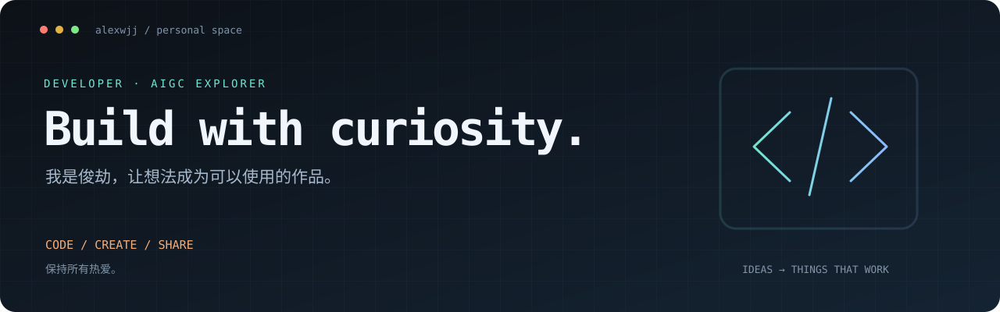

  

  <a href="https://alexwjj.weightbook.icu/">个人空间 ↗</a> &nbsp; / &nbsp;
  <a href="https://alexwjj.github.io/">技术博客</a> &nbsp; / &nbsp;
  <a href="https://juejin.cn/user/3386151545609837/posts">掘金</a> &nbsp; / &nbsp;
  <a href="https://space.bilibili.com/64755432">Bilibili</a> &nbsp; / &nbsp;
  <a href="https://x.com/junjiezed">X</a>

### Hey, I'm 俊劫 👋

开发者，AIGC 探索者。在杭州写代码，也把想法做成小工具。

从前端工程、性能优化到 AI 编程工作流，喜欢亲手实现、持续打磨，再把过程分享出来。

- **Build** · Web 应用、浏览器扩展，以及解决具体问题的小工具。
- **Explore** · Claude Code、Codex、pi，以及 Skills / MCP 驱动的开发方式。
- **Share** · 在博客和掘金记录前端实践、踩坑与思考。

### 01 / 正在创造

| 项目 | 它解决什么问题 |
| :--- | :--- |
| **[x-reader ↗](https://github.com/alexwjj/x-reader)** | 为 X 长文生成可点击的章节目录，让长文更好读。原生 JavaScript · Chrome 扩展 |
| **[个人工作空间 ↗](https://alexwjj.weightbook.icu/)** | 集中整理作品、AI 工具、工作流与文章。[源码](https://github.com/alexwjj/alexwjj-hub) |

### 02 / 一路积累

| 项目 | 关键词 |
| :--- | :--- |
| **[前端技术博客](https://github.com/alexwjj/alexwjj.github.io)** | VuePress · 前端知识与实践记录 |
| **[React-TypeScript](https://github.com/alexwjj/React-TypeScript)** | React + TypeScript · 动手实践 |
| **[vue-iframe-print](https://github.com/alexwjj/vue-iframe-print)** | Vue 插件 · 页面局部打印 |
| **[html-to-pdf](https://github.com/alexwjj/html-to-pdf)** | Egg + Puppeteer · HTML 转 PDF |
| **[micro-fe](https://github.com/alexwjj/micro-fe)** | qiankun · 微前端实践 |
| **[fe-optimize](https://github.com/alexwjj/fe-optimize)** | 前端性能优化 · [配套分享](https://github.com/alexwjj/fe-ppt) |

### 03 / 工具与关注

**日常开发** &nbsp; JavaScript / TypeScript · React / Vue · Node.js  
**持续探索** &nbsp; AI Coding · Agent 工作流 · Skills · MCP · 开发者体验

---

  欢迎交流想法、反馈问题，或一起做点有意思的东西。 
  <a href="mailto:798595965@qq.com">Email · 联系我</a>

保持所有热爱，持续创造。

